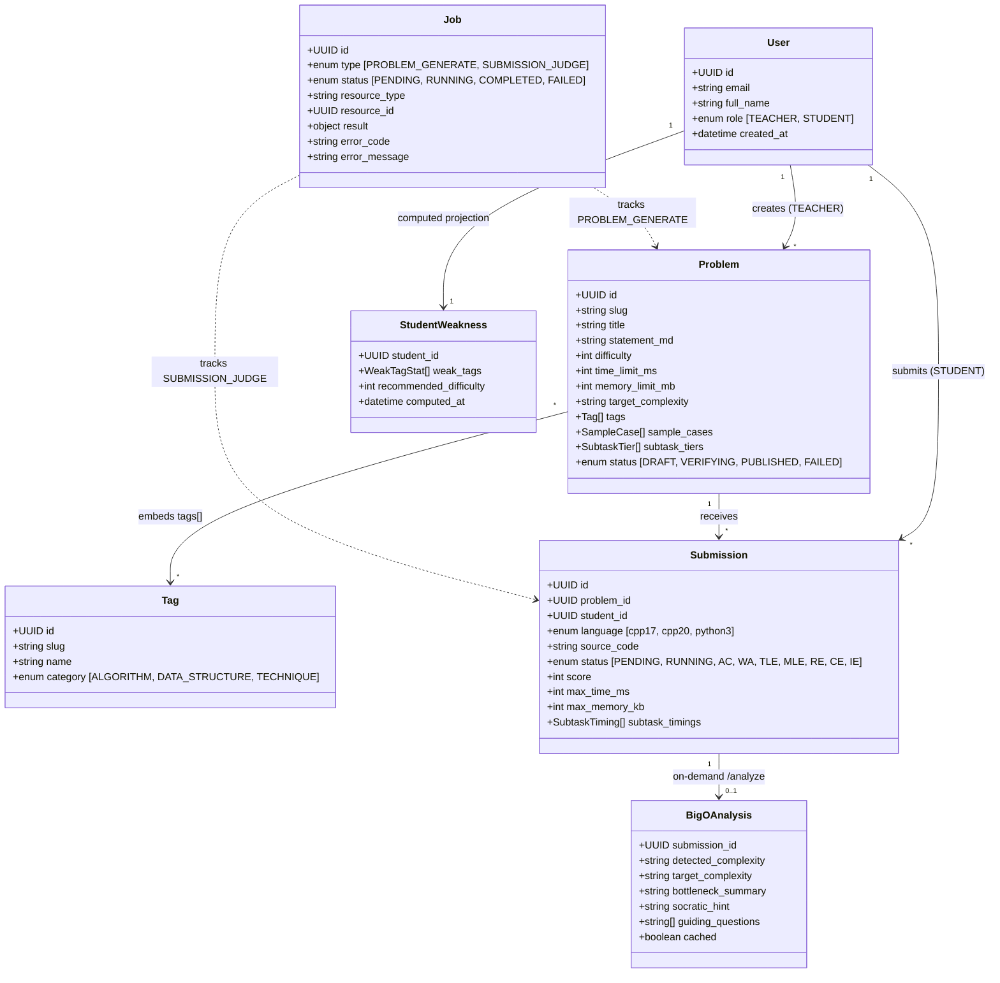
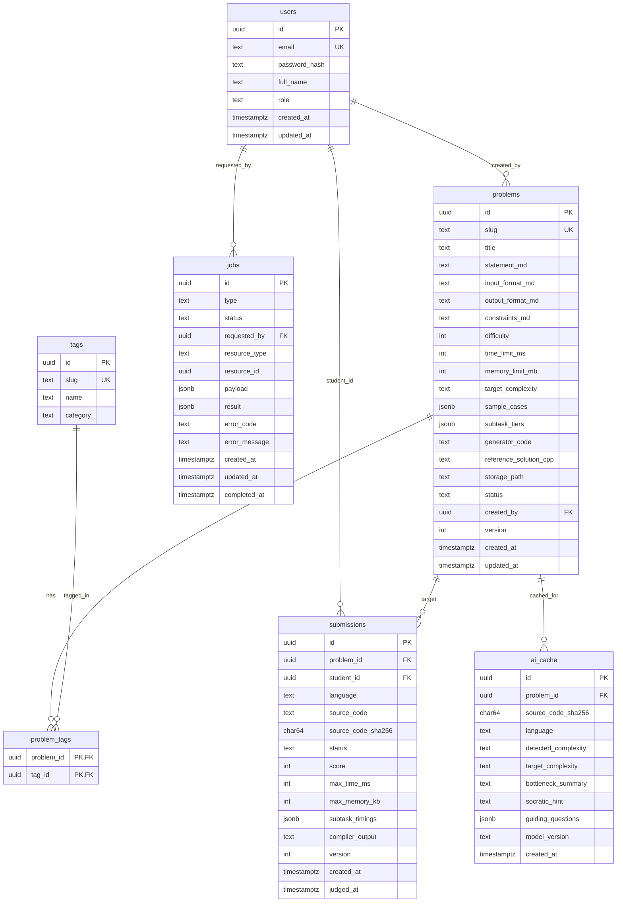
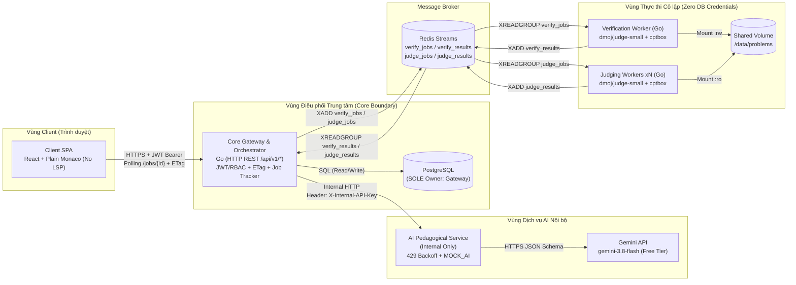
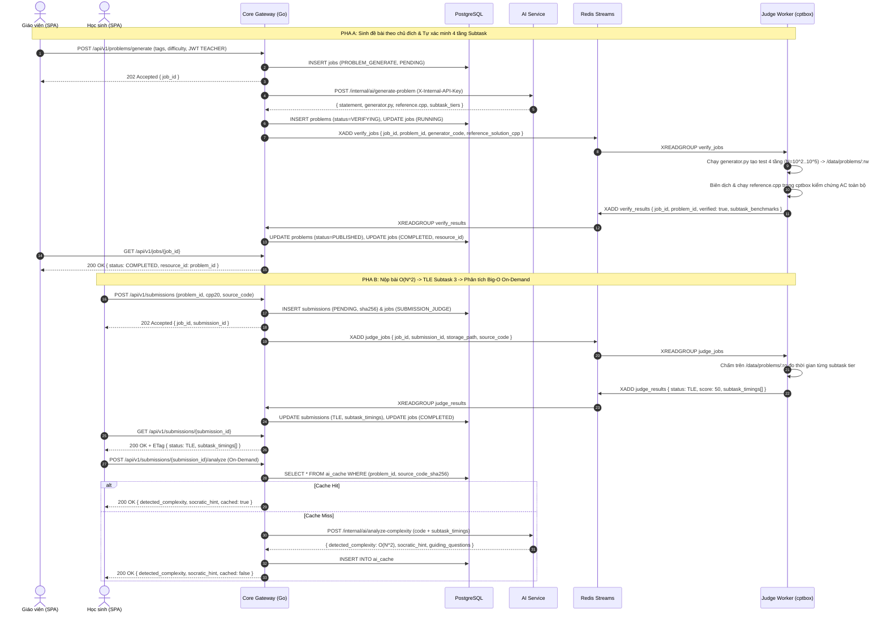

# Tài liệu Thiết kế Hệ thống (Design Document) — AlgoBloom

Tài liệu này mô tả chi tiết mô hình tài nguyên REST, sơ đồ cơ sở dữ liệu PostgreSQL, sự tách biệt giữa Resource Model và Database Schema, kiến trúc SOA (Gateway Orchestration), luồng tuần tự trọng tâm và chiến lược kiểm thử của **AlgoBloom**.

---

## 1. Mô hình Tài nguyên (Resource Model) & Quy ước Đặt tên

### 1.1 Quy ước Đặt tên & Định danh
- **Base path:** `/api/v1`
- **Tên tài nguyên:** Danh từ số nhiều, chữ thường, phân cách bằng dấu gạch ngang (`kebab-case`) cho đường dẫn: `/problems`, `/submissions`, `/tags`, `/jobs`, `/students/{studentId}/weaknesses`.
- **Trường JSON:** `snake_case` thống nhất toàn hệ thống (OpenAPI, PostgreSQL, Redis Streams, AI Service).
- **Định danh (Identifiers):** Tất cả thực thể chính sử dụng **UUID v4** (`string`, format `uuid`) để tránh lộ quy mô dữ liệu và hỗ trợ tạo ID không xung đột giữa các dịch vụ.
- **Caching:** Các endpoint đọc tài nguyên bất biến hoặc ít thay đổi (`GET /api/v1/problems/{problemId}`, `GET /api/v1/submissions/{submissionId}`) trả về weak `ETag` (ví dụ `W/"problem-<uuid>-v1"`) và hỗ trợ `If-None-Match` -> `304 Not Modified`.
- **Tác vụ bất đồng bộ:** Các thao tác tốn thời gian (`POST /api/v1/problems/generate`, `POST /api/v1/submissions`) trả về `202 Accepted` kèm `job_id` để client polling tại `GET /api/v1/jobs/{jobId}`.

### 1.2 Sơ đồ Mô hình Tài nguyên (Resource Model Diagram)

---

## 2. Sơ đồ Cơ sở Dữ liệu PostgreSQL (ERD)

Core Gateway (`services/gateway/`) là thành phần **duy nhất** sở hữu schema và kết nối trực tiếp tới PostgreSQL. Định nghĩa DDL chuẩn nằm tại `services/gateway/migrations/001_init.sql`.

---

## 3. Vì sao Resource Model KHÁC với Database Schema?

Việc tách biệt API Resource Model khỏi cấu trúc bảng quan hệ là nguyên tắc thiết kế bắt buộc để tránh rò rỉ chi tiết lưu trữ nội bộ, bảo vệ thông tin nhạy cảm và tối ưu hóa trải nghiệm client:

| Khía cạnh | Trong PostgreSQL Schema | Trong Public REST Resource Model | Lý do tách biệt |
| :--- | :--- | :--- | :--- |
| **Quan hệ nhiều-nhiều `problems` <-> `tags`** | Bảng trung gian `problem_tags(problem_id, tag_id)` chuẩn hóa 3NF | Mảng nhúng `tags: Tag[]` ngay bên trong đối tượng `Problem` | Tránh bài toán N+1 request phía Frontend; bảng `problem_tags` không có ý nghĩa độc lập với người dùng API. |
| **Hồ sơ điểm yếu học sinh (`StudentWeakness`)** | **Không có bảng riêng** (tính toán tổng hợp động qua `JOIN` giữa `submissions`, `problems`, `problem_tags`, `tags`) | Tài nguyên chỉ đọc `GET /api/v1/students/{studentId}/weaknesses` | Dữ liệu dẫn xuất (computed projection), tính trực tiếp từ lịch sử nộp bài để tránh đồng bộ dư thừa ở MVP. |
| **Bảng `ai_cache`** | Lưu trữ khóa duy nhất `(problem_id, source_code_sha256)` cùng metadata `model_version` | **Ẩn hoàn toàn** khỏi public API; chỉ biểu diễn qua cờ `cached: boolean` trong response của `POST /submissions/{id}/analyze` | Caching là chiến lược tối ưu hạ tầng nội bộ; client không cần biết hay thao tác trực tiếp bảng cache. |
| **Trường nhạy cảm / nội bộ trên `users` và `problems`** | `users.password_hash`, `problems.generator_code`, `problems.reference_solution_cpp`, `problems.storage_path`, `submissions.source_code_sha256` | **Loại bỏ hoàn toàn** khỏi response công khai (đặc biệt ngăn học sinh thấy `reference_solution_cpp` hay đường dẫn filesystem `/data/problems/...`) | Bảo mật xác thực, chống gian lận lời giải mẫu và che giấu cấu trúc hệ thống tập tin máy chủ. |
| **Cột `version` cho concurrency/caching** | Cột số nguyên `version INT` trong `problems` và `submissions` | Ánh xạ thành HTTP Header `ETag: W/"problem-<id>-v<version>"` | Tận dụng cơ chế chuẩn HTTP `304 Not Modified` thay vì buộc client tự quản lý số phiên bản trong JSON body. |
| **Tài nguyên bất đồng bộ `Job`** | Bảng `jobs` lưu cả `payload` nội bộ và liên kết mềm `(resource_type, resource_id)` | Trả về trạng thái chuẩn hóa (`PENDING`/`RUNNING`/`COMPLETED`/`FAILED`) kèm `resource_id` khi hoàn tất | Che giấu chi tiết hàng đợi Redis Streams và cho phép mở rộng thêm loại job mới mà không phá vỡ hợp đồng REST. |

---

## 4. Kiến trúc Hệ thống SOA (System Architecture Diagram)

Sơ đồ dưới đây thể hiện rõ 4 thành phần dịch vụ, Redis Streams Broker và các **ranh giới tin cậy (Trust Boundaries)**:

### Tóm tắt Ranh giới Tin cậy (Trust Boundaries)
1. **Public Edge (`SPA -> Gateway`):** Chỉ cho phép HTTPS + JWT Bearer (`TEACHER` / `STUDENT`). Mọi đầu vào đều được validate schema và phân quyền RBAC tại Gateway.
2. **Internal AI Boundary (`Gateway -> AI Service`):** AI Service không mở port ra ngoài Internet; bắt buộc kiểm tra header `X-Internal-API-Key` khớp secret nội bộ.
3. **Sandbox Isolation (`Redis Streams -> Judge Workers`):** Judge Workers chạy code không tin cậy bên trong `cptbox`, hoàn toàn **không có biến môi trường hay kết nối PostgreSQL**. Chỉ Verification Worker có quyền ghi `:rw` vào `/data/problems`; Judging Workers chỉ đọc `:ro`.

---

## 5. Sơ đồ Tuần tự Luồng Trọng tâm (Sequence Diagram)

Sơ đồ mô tả trọn vẹn 2 pha của luồng trọng tâm: **(A) Tự xác minh khi sinh đề bài** và **(B) Nộp bài chấm phân tầng + Phân tích Big-O On-Demand**:

---

## 6. Ngăn xếp Công nghệ & Chiến lược Kiểm thử

### 6.1 Tech Stack
- **Frontend:** React + TypeScript + `@monaco-editor/react` (thuần, không LSP), Fetch/Axios client.
- **Core Gateway:** Go (`net/http` / router chuẩn), PostgreSQL 16 (`pgx`), Redis 7 Streams (`go-redis`).
- **Judge Worker:** Go Redis Streams consumer bọc `dmoj/judge-small` (`dmoj-cli` + `cptbox`).
- **AI Service:** Python (FastAPI) hoặc Go (Long chốt dứt điểm trong Tuần 12) gọi `gemini-3.8-flash` với structured JSON output.
- **Contract & Mock Tooling:** OpenAPI 3.0.3, Swagger UI (`swaggerapi/swagger-ui`), Stoplight Prism 4 (`stoplight/prism:4`).

### 6.2 Chiến lược Kiểm thử (Testing Strategy)
1. **Tuần 12 (Contract-First Validation):**
   - Kiểm tra cú pháp OpenAPI 3.0.3 (zero broken `$ref`, đúng cấu trúc response/error).
   - Chạy `docker-compose.mock.yml` (Swagger UI + Prism Mock) để kiểm chứng luồng happy path và các mã lỗi `401`/`403`/`422`.
   - Chạy bộ Postman Collection (`tests/postman/algobloom-w12-mock.postman_collection.json`) trực tiếp trên Prism (`{{base_url}} = http://localhost:4010`).
2. **Tuần 13–14 (Unit, Integration & Sandbox Verification):**
   - **Go Gateway:** Unit/handler tests bằng `net/http/httptest` (JWT/RBAC, unified error format, `ETag` `304`, cache hit/miss `ai_cache`).
   - **Judge Worker:** Kiểm thử tích hợp với Redis Streams thật và mã nguồn C++ mẫu (`AC` $O(N \log N)$ vs `TLE` $O(N^2)$) chạy trong `cptbox`.
   - **AI Service:** Kiểm thử JSON Schema validation trên cả hai chế độ `MOCK_AI=true` và `gemini-3.8-flash` thật, mô phỏng retry `429`.
   - **End-to-End Contract:** Chạy lại chính bộ Postman/Newman collection của Tuần 12 nhưng trỏ `{{base_url}}` sang Go Gateway thật (`http://localhost:8000`) để bảo đảm không lệch hợp đồng.
